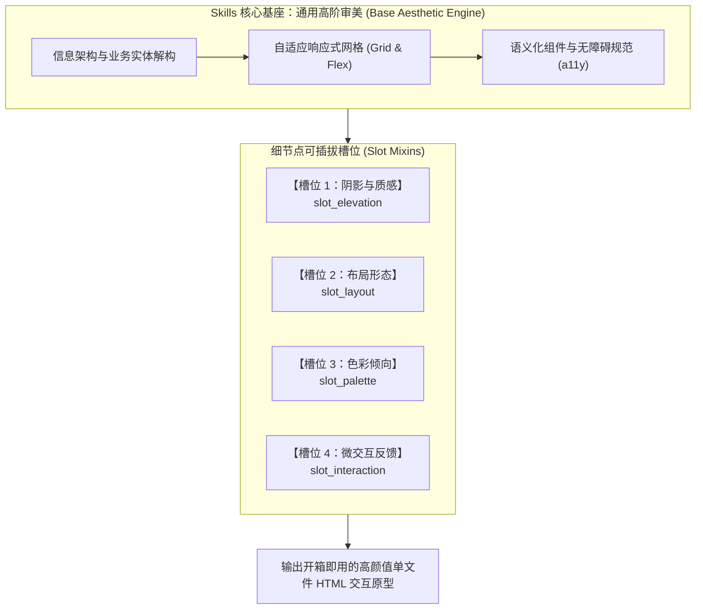

# Pluggable UI Designer (可插拔前端设计技能)

> **基于“通用审美底座 + 细节点积木式插拔（Slot Mixins）”理念打造的新一代 AI Agent 前端 UI 原型设计技能。**

[](https://github.com/Ikaros-521/pluggable-skills)
[](LICENSE)
[]()

[English Documentation (README_EN.md)](README_EN.md) | [主规范仓库 (pluggable-skills)](https://github.com/Ikaros-521/pluggable-skills)

---

## 💡 为什么需要本技能？

### 传统 AI 生成 UI 的致命痛点
当前市面上的 AI 生成代码或 UI 原型常常存在两大问题：
1. **严重的“AI Slop”审美同质化**：千篇一律的纯白背景 + 紫蓝渐变大按钮 + 毫无节制的泡泡大圆角卡片，缺乏真实设计系统的约束。
2. **单一庞杂的硬编码 Prompt**：如果要微调质感（如将大阴影改成精密发丝线），或将栅格调整为 Bento Grid，传统单体 Prompt 往往牵一发而动全身，导致结构失控崩溃。

### 我们的解决方案：细节点积木式插拔架构
大模型本身已具备优秀的通用现代设计审美。本技能将“基座审美”与“容易产生分歧的细节点”彻底解耦：
* **核心美学底座（Core Aesthetic Base）**：内置现代顶尖 UI 设计规范（严谨字距、信息层次悬殊对比、WCAG AA 级无障碍对比度、响应式流动）。
* **4 大细节点插拔槽位（Slot Mixins）**：将质感、布局、配色倾向、微交互拆分成独立的轻量插件。用户只需一句话，即可像搭积木一样单独替换任意 1~2 个细节点！



---

## 🧩 细节点插件库一览 (Plugins Matrix)

| 槽位类型 | 插件名称 | 核心美学与特性 |
| :--- | :--- | :--- |
| **质感与层次**<br>`slot_elevation` | **`plugin_fine_hairline.md`** | **精工发丝线**：单像素微弱描边 + 顶部微内高光，去除大黑影，极具 Linear/Raycast 工业精密度。 |
| | **`plugin_soft_diffusion.md`** | **柔和弥散轻盈**：超大模糊半径、低透明度双层投影，营造 Apple/Stripe 般的悬浮通透感。 |
| | **`plugin_flat_zen.md`** | **素雅纯扁平**：彻底零阴影，依靠背景微差色阶与素雅线框分层，回归纯粹功能主义。 |
| **布局骨架**<br>`slot_layout` | **`plugin_bento_grid.md`** | **Bento 错落智能网格**：跨2列2行主角大卡 + 紧凑单格次要指标，视觉节奏起伏生动。 |
| | **`plugin_sidebar_dock.md`** | **悬浮侧边 Dock**：紧凑图标导航栏 + 沉浸式主工作区画布，宽屏专业生产力体验。 |
| **色彩调性**<br>`slot_palette` | **`plugin_warm_stone.md`** | **温润暖调石系**：暖灰 Stone 阶梯与纸张米白，带来类似 Notion/Substack 般的温润阅读舒适感。 |
| | **`plugin_cold_slate.md`** | **冷调工业蓝灰**：Slate 蓝灰 + 经典电光蓝点睛，大厂企业级云原生控制台首选。 |
| **微交互反馈**<br>`slot_interaction` | **`plugin_tactile_bounce.md`** | **物理弹性微触感**：悬浮微浮起（`-translate-y-0.5`），按压微凹陷（`active:scale-[0.97]`）。 |
| | **`plugin_subtle_glow.md`** | **呼吸微发光**：健康状态呼吸灯（`animate-ping`）与聚焦微光晕扩散。 |

---

## 🎨 渐进式演变实战演示 (Examples)

我们以同一个“**AI Agent 任务编排调度中心**”为例，生成了 3 个可直接在浏览器中打开的单文件交互原型（位于 [`examples/`](examples/) 目录下）：

1. **基座原型：通用顶级审美版** ([`examples/01_default_base.html`](examples/01_default_base.html))
   * 采用通用基座，无插拔插件覆盖。呈现标准、干净、高对比度的大厂生产力风格。
2. **细节点演变 1：发丝线质感 + 暖石色系** ([`examples/02_fine_hairline_warm_stone.html`](examples/02_fine_hairline_warm_stone.html))
   * 业务结构与指标 100% 保持一致，仅挂载 `plugin_fine_hairline` 与 `plugin_warm_stone`。界面瞬间蜕变为温润如纸、精工仪表的质感。
3. **细节点演变 2：Bento 错落网格 + 弹性触感微动效** ([`examples/03_bento_grid_tactile_bounce.html`](examples/03_bento_grid_tactile_bounce.html))
   * 仅挂载 `plugin_bento_grid` 与 `plugin_tactile_bounce`。界面重组为生动的便签错落大盘，按钮与卡片具备真实的物理弹性按压回弹手感。

---

## 🚀 在 AI Agent 中使用（以 Antigravity 为例）

本仓库已封装为标准的 Agent Skill 结构，位于 `skills/ui-designer/`。

### 1. 自然语言交互体验

只需直接对您的 Agent 下达需求指令：

#### 场景 A：使用默认通用审美生成
> **用户**：“*帮我设计一个云原生容器监控看板的前端原型*”  
> **Agent**：启动通用美学底座，输出干净、响应式、符合 WCAG AA 规范的单文件 HTML。

#### 场景 B：单点细节点精准替换
> **用户**：“*把刚才那个界面的阴影换成微发光发丝线，色系换成温润暖石色*”  
> **Agent**：保留所有核心业务逻辑，仅拔插 `plugin_fine_hairline.md` 与 `plugin_warm_stone.md`，精准重构质感与配色！

#### 场景 C：组合布局与动效
> **用户**：“*用 Bento Grid 重排这个页面，并且让按钮和卡片有物理按压弹性反馈*”  
> **Agent**：挂载 `plugin_bento_grid.md` 与 `plugin_tactile_bounce.md` 交付！

---

## 📂 仓库目录结构

```text
pluggable-ui-designer/
├── skills/
│   └── ui-designer/
│       ├── SKILL.md                 # 核心技能手册（定义通用基座与 4 大槽位契约）
│       └── plugins/                 # 细节点可插拔插件库
│           ├── elevation/           # 质感与阴影槽位插件
│           │   ├── plugin_fine_hairline.md
│           │   ├── plugin_soft_diffusion.md
│           │   └── plugin_flat_zen.md
│           ├── layout/              # 布局结构骨架槽位插件
│           │   ├── plugin_bento_grid.md
│           │   └── plugin_sidebar_dock.md
│           ├── palette/             # 色彩调性槽位插件
│           │   ├── plugin_warm_stone.md
│           │   └── plugin_cold_slate.md
│           └── interaction/         # 微交互与反馈槽位插件
│               ├── plugin_tactile_bounce.md
│               └── plugin_subtle_glow.md
├── examples/                        # 端到端单文件自包含 HTML 演示
│   ├── 01_default_base.html
│   ├── 02_fine_hairline_warm_stone.html
│   └── 03_bento_grid_tactile_bounce.html
├── README.md                        # 中文文档
├── README_EN.md                     # 英文文档
└── .gitignore
```

---

## 📄 开源许可

本项目遵循 [MIT License](LICENSE) 开源协议。欢迎提交新的细节点插件！
