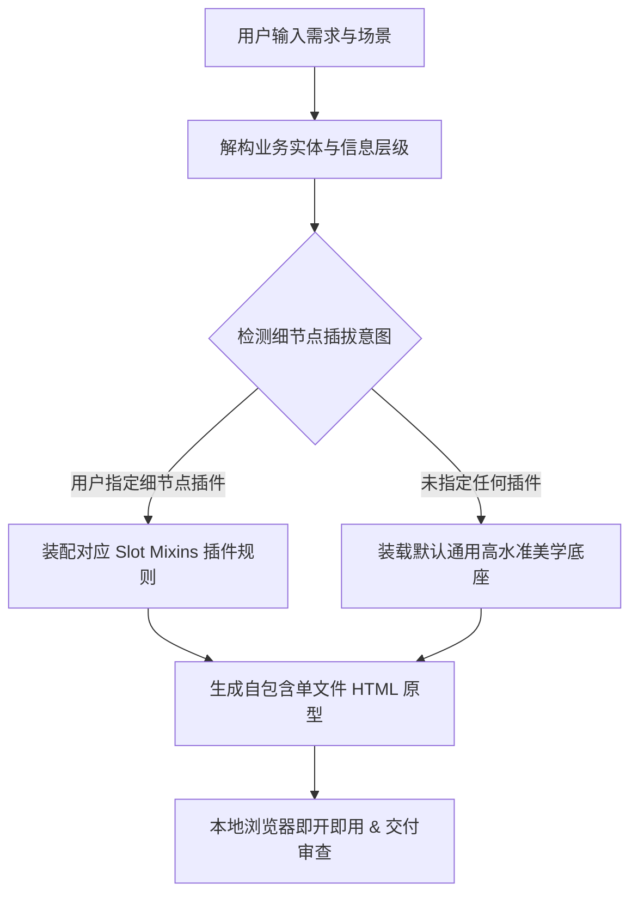

# UI Designer (可插拔前端设计技能)

本技能专为高质量前端 UI 原型、仪表盘、落地页及独立组件设计打造。

不同于传统将整套风格捆绑死板的单体技能，本技能遵循**“高水准通用底座 + 细节点积木式插拔（Slot Mixins）”**架构：
1. **通用审美底座**：内化现代顶尖 UI 设计规范（呼吸感排版、清晰信息层级、无障碍色彩、自适应响应式布局）。
2. **细节点插件槽位**：将质感、布局形态、色系调性、微交互反馈拆分为独立的轻量 Markdown 插件，支持单点热插拔，精准替换。

---

## 一、 核心工作流（Pipeline）

1. **需求理解与信息架构（IA）**：
   - 提取核心数据指标（Metrics）、主要交互动作（Primary Action）、次要信息与辅助控件。
   - 拒绝生成空洞的假界面，所有按钮与表单均需配备真实语义与轻量状态逻辑。
2. **细节点槽位装配（Slot Mixins Assembly）**：
   - 检查用户上下文是否指定了特定细节点（如：“*阴影换成微发光单像素线*” 或 “*布局改成 Bento Grid*”）。
   - 从 `plugins/` 目录读取对应细节点规则进行局部覆盖，未声明的维度使用默认现代通用规范。
3. **自包含原型渲染交付（Zero-Config Delivery）**：
   - 生成无需编译打包的单文件 `.html`。
   - 头部引入现代 Tailwind CSS 与标准字体图标，保证用户双击文件即可在任何现代浏览器中完美呈现。

---

## 二、 4 大细节点插拔槽位（Slot Specifications）

| 槽位标识 (Slot) | 职责与覆盖范围 | 默认基座表现 | 可选插件目录 |
| :--- | :--- | :--- | :--- |
| **`slot_elevation`** (质感与层次) | 控制边框（Border）、阴影模型（Shadow）、内发光（Inset Glow）、材质表面 | 干净微边框 (`border-slate-200` / `border-zinc-800`) 配合细腻轻投影 | `plugins/elevation/` |
| **`slot_layout`** (布局结构骨架) | 控制信息区块的宏观排布、多栏自适应、栅格分配、导航停靠 | 标准响应式流式布局（上导航栏 + 核心内容容器） | `plugins/layout/` |
| **`slot_palette`** (色彩倾向与调性) | 控制主底色、表面色、文字阶梯明度、品牌焦点强调色 | 现代中性灰阶（Slate 系）+ 经典企业级冷蓝/钴蓝强调 | `plugins/palette/` |
| **`slot_interaction`** (微交互与微反馈) | 控制悬浮位移（Hover Lift）、点击形变（Active Scale）、呼吸动效、过渡时间 | 平滑淡入淡出（`transition-colors duration-150`） | `plugins/interaction/` |

---

## 三、 通用美学底座规范（Base Aesthetic Engine）

无论是否挂载细节点插件，所有生成的原型均默认遵循以下无妥协的设计底线：

1. **信息阶梯与排版节律**：
   - 标题与正文必须形成剧烈字号与字重落差（例如：页面大标题 `text-2xl font-bold tracking-tight` 与辅助文字 `text-xs font-normal text-muted`）。
   - 数字与统计指标优先采用等宽字体（`font-mono` 或 `tabular-nums`），保证高低位数字对齐不跳动。
2. **容器与间距呼吸感**：
   - 避免元素局促拥挤，主外边距与内边距统一采用 4/8 像素网格倍数（`p-4`、`p-6`、`p-8`，`gap-4`、`gap-6`）。
   - 交互卡片或按钮内边距严格保持舒适手感（按钮最低点击热区 $\ge 38\text{px}$）。
3. **无障碍设计（Accessibility & a11y）**：
   - 严格禁止在浅色背景上出现淡灰色不可读正文（正文对比度必须满足 WCAG AA 4.5:1）。
   - 按钮、输入框必须包含明确的 `:focus-visible` 焦点光环。
4. **拒绝 "AI Slop" 廉价套路**：
   - 严禁盲目使用大面积突兀的紫色到粉色渐变大背景。
   - 严禁空洞的图标+无意义文字占位。

---

## 四、 插件发现与装配指令规则

Agent 在接收到用户的自然语言指令时，应按如下规则精准映射：

* **识别到阴影/质感诉求**：
  - “微发光 / 单像素硬线 / 精工感 / 极客线框” $\to$ 挂载 `plugins/elevation/plugin_fine_hairline.md`
  - “悬浮感 / 柔和多层弥散 / 现代白底高级投影” $\to$ 挂载 `plugins/elevation/plugin_soft_diffusion.md`
  - “纯扁平 / 零阴影 / 素雅克制” $\to$ 挂载 `plugins/elevation/plugin_flat_zen.md`
* **识别到布局结构诉求**：
  - “Bento Grid / 便签网格 / 错落卡片流” $\to$ 挂载 `plugins/layout/plugin_bento_grid.md`
  - “侧边 Dock / 悬浮导航 / 左窄右宽工作台” $\to$ 挂载 `plugins/layout/plugin_sidebar_dock.md`
  - “主从分栏 / 左侧列表右侧详情” $\to$ 挂载 `plugins/layout/plugin_split_detail.md`
* **识别到色彩调性诉求**：
  - “暖灰 / 纸质感 / Notion风 / 温暖中性” $\to$ 挂载 `plugins/palette/plugin_warm_stone.md`
  - “冷静工业 / 科技蓝灰 / 现代SaaS” $\to$ 挂载 `plugins/palette/plugin_cold_slate.md`
  - “暗夜翡翠绿 / 金融增长 / 生态生机” $\to$ 挂载 `plugins/palette/plugin_emerald_nature.md`
* **识别到微动效诉求**：
  - “弹性触感 / 物理回弹 / 按压微凹” $\to$ 挂载 `plugins/interaction/plugin_tactile_bounce.md`
  - “呼吸发光 / 状态脉冲 / 聚焦微晕” $\to$ 挂载 `plugins/interaction/plugin_subtle_glow.md`
